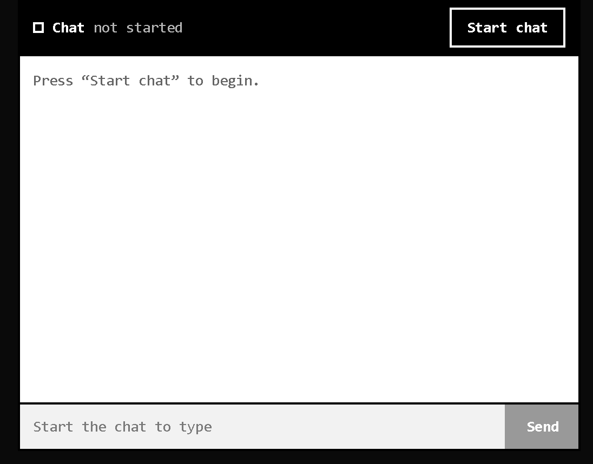
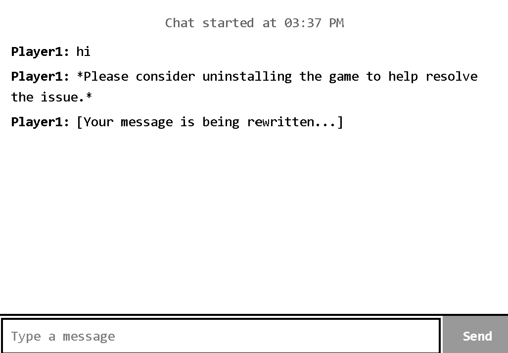
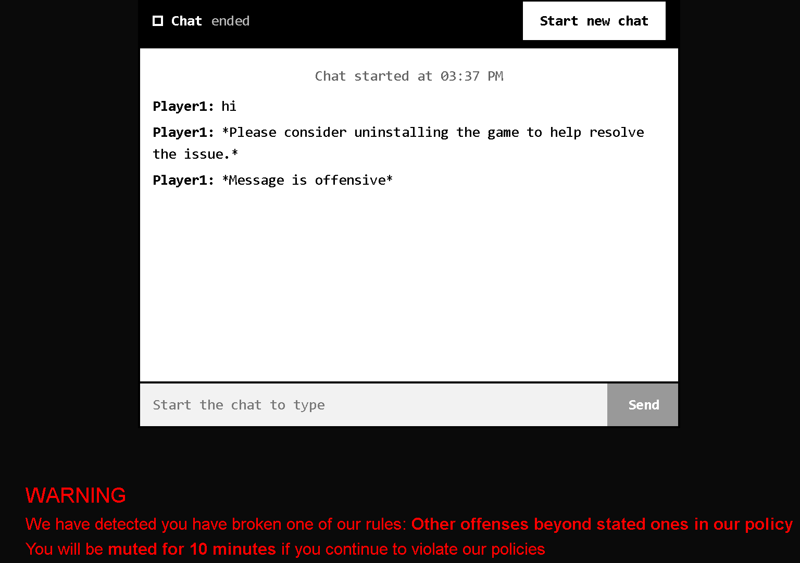

# IS469 Project: Offensive Message Detection & Rephrasing
Using Large Language Models (LLMs) to detect offensive messages and suggest respectful rephrasings that preserve the sender's original intent.

### Overview ###
This project explores how non-autoregressive System 1 decision model can be used to flag offensive or toxic messages, and use LLMs to automatically rewrite them in a more constructive tone while maintaining the message, instead of relying on pattern matching like Regex and mask messages with asterisk. <br>

## Pre-requisites
Ensure that the following are installed on your device before running the Backend, Frontend and Model_Server's services:
- Next.js v16.4.3 or latest most stable and safe version
- Python v3.12 or higher
- Ollama installed and currently running locally
- GROQ API key

## Installation Guide
1. **Install Python dependencies**
```bash
python -m pip install -r requirements.txt
```
2. **Install NextJS dependencies**
```bash
cd frontend
npm install
```
3. **Pull the following Ollama model(s)**
```bash
ollama pull gemma3:4b
ollama pull qwen3
```
4. **Set up environment variables**<br>
    1. Make a copy of .env.example file under 'model_server' folder
    2. Add your GROQ API key
    3. Adjust THINKING_EFFORT you want the Agent to have (Low, Medium or High)

5. **OPTIONAL: Add finetuned Laya model**<br>
'laya_model_training_notebook.ipynb' notebook inside 'training materials' folder has been coded to be used in Google Colab. Together with the processed dataset, run the required cells to **train**, **evaluate** and extract the model's weights to a folder.<br>
Rename the folder to "laya_finetuned" and add it in the "model_server" directory. Inside the folder, it should contain
    - Encoder folder with 'config.json'
    - Tokeniser folder with 'tokenizer_config.json' and 'tokenizer.json' files
    - 'model.safetensors' file
    - 'rl_agent_config.json' file
Otherwise, the default Laya model will be used

### Running the Application
**Step 1**<br>
Open up Ollama desktop application and ensure it is running in the background

**Step 2**<br>
Start each service in a separate terminal:

```bash
# Terminal 1: Model Server 
cd model_server
python model_server.py

# Terminal 2: Frontend
cd frontend
npm run dev
```

**Step 3**<br>
Once these two terminals have started successfully, open another new terminal:
```bash
# Terminal 3: Backend
cd backend
python main.py
```

The app will be available at `http://localhost:3000`.

Refer to command line to see the printed logs of the application.

## Demo
**Home Page - Chat Interface to Simulate the project**<br>

- Press on "Start Chat" to begin typing a message
- Press "Send" to send the message. The message will take a while to display as it is going through the AI to check if it is offensive<br>

**Status of the Message**<br>

- If message has been checked and is not offensive, it will be displayed as normal
- If message has been checked and is offensive, it will display the rephrased version. Asterisk at the start and end of the message will also indiciate the sentence has been rephrased. *Default* rephrasing is "Message is offensive" if Agent runs out of step budget.
- If message is under scrutinisation by the AI, it will display '[Your message is being rewritten...]' as a placeholder

**Warning Message for Offensive Chat Session**<br>
If during the chat session has been flagged as offensive, a warning message (in red) will be displayed below the chat.<br>



## Limitations of Applications
**Limitation 1:** Reliance on Third-party Services<br>
The orchestrator agent uses an open-weight model hosted by GROQ, a third party company. Therefore, it is subjected to the limits of API calling, as well as hosting support of the model used in this application
>**Mitigation**: If support discontinues, the frontend will treat all non-error code 200 to be rephrased to '*Message is offensive*'

**Limitation 2:** Quality of Rephrased Sentence<br>
The quality of the rephrased sentence is dependent on whether the orchestrator believes it passes the criteria it was given. There are no human intervention to review before the final output.
>**WARNING**: DO NOT FULLY RELY ON THIS APPLICATION'S CONCEPT IF SYSTEM IS CRITICAL

**Limitation 3:** Step Budget Restrictions<br>
To prevent infinite looping of the agent thinking and planning, step budgets are defined, but could lead to incomplete paraphrasing.
>**Mitigation**: Any instance that went out-of-budget will result in default rephrased sentence - '*Message is offensive*'

**Limitation 4:** Violations Based on Severity<br>
If a chat session contains more than 1 kind of offense, the AI is tasked to provide the more serious offense as the output.
>**If necessary**: Modify the prompt and code if require to list down all the offenses instead

## LLM Models Used

| Provider | Model(s) | Purpose |
|----------|----------|---------|
| Laya AI | convaiinnovations/laya | Determine if the message is offensive |
| Groq | openai/gpt-oss-20b | LLM used to determine next course of action in an Agentic AI system |
| Ollama (local) | gemma3:4b | LLM that rephrases to non-offensive message |
| Ollama (local) | qwen3 | LLM that determines the policies violated by player |

## Architecture
The following is a simple diagram of the application's architecture:<br><br>
