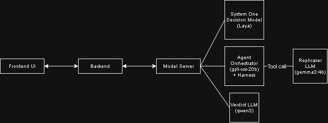

# IS469 Project: Offensive Message Detection & Rephrasing
Using Large Language Models (LLMs) to detect offensive messages and suggest respectful rephrasings that preserve the sender's original intent.

### Overview ###
This project explores how non-autoregressive System 1 decision model can be used to flag offensive or toxic messages, and use LLMs to automatically rewrite them in a more constructive tone while maintaining the message, instead of relying on pattern matching like Regex and mask messages with asterisk. <br>

## Demo
Users submit a message, the system classifies whether it is offensive, and, if so, returns a rephrased version.
<To add the pictures>

## Pre-requisites
Ensure that the following are installed on your device before running the Backend, Frontend and Model_Server's services:
- Next.js v16.4.3 or latest most stable and safe version
- Python v3.12 or higher
- Ollama installed and currently running locally
- GROQ API key

## Installation Guide
1. **Install Python dependencies**
```bash
python -m pip install -r requirements.txt
```
2. **Install NextJS dependencies**
```bash
cd frontend
npm install
```
3. **Pull the following Ollama model(s)**
```bash
ollama pull gemma3:4b
ollama pull qwen3
```
4. **Set up environment variables**<br>
    1. Make a copy of .env.example file under 'model_server' folder
    2. Add your GROQ API key
    3. Adjust THINKING_EFFORT you want the Agent to have (Low, Medium or High)

5. **OPTIONAL: Add finetuned Laya model**<br>
Rename the folder to "laya_finetuned" and add it in the "model_server" directory. Inside the folder, it should contain
    - Encoder folder with 'config.json'
    - Tokeniser folder with 'tokenizer_config.json' and 'tokenizer.json' files
    - 'model.safetensors' file
    - 'rl_agent_config.json' file
Otherwise, the default Laya model will be used

### Running the Application

Start each service in a separate terminal:

```bash
# Terminal 1: Model Server
cd model_server
python model_server.py

# Terminal 2: Backend
cd backend
python main.py

# Terminal 3: Frontend
cd frontend
npm run dev
```
The app will be available at `http://localhost:3000`.

Refer to command line to see the printed logs of the application.

## Limitations of Applications
**Limitation 1:** Reliance on Third-party Services<br>
The orchestrator agent uses an open-weight model hosted by GROQ, a third party company. Therefore, it is subjected to the limits of API calling, as well as hosting support of the model used in this application
>**Mitigation**: If support discontinues, the frontend will treat all non-error code 200 to be rephrased to '*Message is offensive*'

**Limitation 2:** Quality of Rephrased Sentence<br>
The quality of the rephrased sentence is dependent on whether the orchestrator believes it passes the criteria it was given. There are no human intervention to review before the final output.
>**WARNING**: DO NOT FULLY RELY ON THIS APPLICATION'S CONCEPT IF SYSTEM IS CRITICAL

**Limitation 3:** Step Budget Restrictions
To prevent infinite looping of the agent thinking and planning, step budgets are defined, but could lead to incomplete paraphrasing.
>**Mitigation**: Any instance that went out-of-budget will result in default rephrased sentence - '*Message is offensive*'

## LLM Models Used

| Provider | Model(s) | Purpose |
|----------|----------|---------|
| Laya AI | convaiinnovations/laya | Determine if the message is offensive |
| Groq | openai/gpt-oss-20b | LLM used to determine next course of action in an Agentic AI system |
| Ollama (local) | gemma3:4b | LLM that rephrases to non-offensive message |
| Ollama (local) | qwen3 | LLM that determines the policies violated by player |

## Architecture
The following is a simple diagram of the application's architecture:<br><br>
