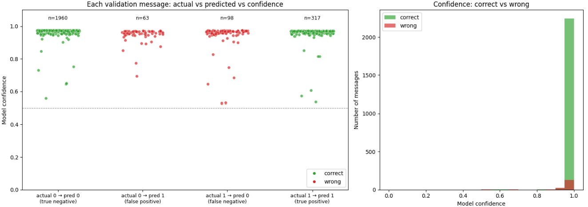

## Results from Running Notebook
*Lastest Run: 7th Oct 2026*

### Training Parameters
*train_test_split seed* = 42 
EPOCHS      = 2 &nbsp;&nbsp;&nbsp;&nbsp; *see 'Epoch Training Results' section for testing other epoch numbers* 
MICRO_BATCH = 8 
GRAD_ACCUM  = 4 
GROUP_SIZE  = 4 
LR_ENCODER, LR_HEAD = 2.5e-5, 1.0e-4 
SIGMA_START, SIGMA_END = 0.4, 0.1 

### Answer Confidence against Test Set

From the graph above:
- Mean confidence, correct predictions: 0.97
- Mean confidence, wrong predictions:   0.945

### Evaluation Metrics
Overall Accuracy: 0.934

**Classification Report**
| | precision | recall | f1 score
|------|----------|---------|--------|
| not offensive (0) | 0.95 | 0.97 | 0.96 |
| offensive (1) | 0.83 | 0.76 | 0.80 |

### Epoch Training Results (Training, Validation Loss)
| Epoch | Training Loss | Validation Loss |
|------|----------|---------|
| 1 | 0.9545 | 0.9049 |
| 2 | 0.7461 | 0.8882 |
| 3 | 0.7304 | 0.8893 |
| ... | ... | ... |

Therefore, Epoch 2 was chosen as validation loss is the **lowest** before turning back.